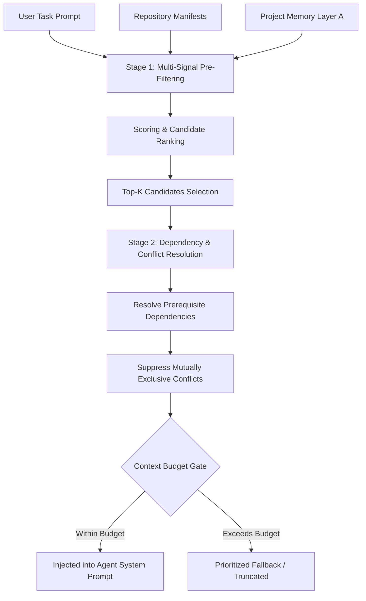

# CodeMind Phase 5 — Dynamic Skills Discovery and Execution Engine: Implementation Report

## Executive Summary

Phase 5 introduces a model-independent, extensible skills discovery and execution engine to CodeMind CLI. Skills in CodeMind are versioned, declarative engineering workflows encapsulated in standard markdown (`SKILL.md`) with YAML frontmatter. They provide specialized procedures, architectural constraints, tool recommendations, and verification requirements without requiring model fine-tuning, cloud dependencies, or privileged execution boundaries.

All skills operate under an **untrusted prompt data** security model: skills provide procedural instructions to the agent's context budget but cannot bypass the `WorkspaceSandbox`, override permission checks, or execute unverified shell commands.

---

## 1. Skill Manifest Specification (`SKILL.md`)

Each skill is self-contained within its own directory and defined by a human- and machine-readable `SKILL.md` file.

### Schema & Validation (`src/codemind/skills/models.py`)

The skill definition adheres to a strict Pydantic v2 schema:

```python
class SkillTrigger(BaseModel):
    manifests: list[str] = Field(default_factory=list)  # Triggered by presence of pyproject.toml, package.json, etc.
    globs: list[str] = Field(default_factory=list)      # Matched file glob patterns (*.py, *.tsx)
    keywords: list[str] = Field(default_factory=list)   # Intent keywords from task prompt

class SkillManifest(BaseModel):
    name: str = Field(pattern=r"^[a-z0-9]+(-[a-z0-9]+)*$") # Strict kebab-case
    version: str = Field(pattern=r"^\d+\.\d+\.\d+$")        # SemVer 2.0.0
    description: str = Field(min_length=10, max_length=500)
    category: str
    triggers: SkillTrigger = Field(default_factory=SkillTrigger)
    required_tools: list[str] = Field(default_factory=list)
    dependencies: list[str] = Field(default_factory=list)
    conflicts: list[str] = Field(default_factory=list)
    workflow_steps: list[str] = Field(default_factory=list)
    constraints: list[str] = Field(default_factory=list)
    verification: list[str] = Field(default_factory=list)
    enabled: bool = True
```

### Manifest Example (`src/codemind/skills/builtin/python-backend/SKILL.md`)

```markdown
---
name: python-backend
version: 1.0.0
description: Professional Python backend engineering focusing on clean architecture, PEP 8, robust typing, explicit exception handling, and unit test coverage.
category: backend
triggers:
  manifests:
    - "pyproject.toml"
    - "setup.py"
    - "requirements.txt"
    - "Pipfile"
  globs:
    - "*.py"
  keywords:
    - "python"
    - "fastapi"
    - "django"
    - "flask"
    - "pydantic"
    - "pytest"
    - "backend"
required_tools:
  - read_file
  - create_file
  - apply_patch
  - run_command
dependencies: []
conflicts: []
workflow_steps:
  - "1. Inspect project environment, dependencies (pyproject.toml/requirements.txt), and Python version."
  - "2. Structure implementation cleanly following domain-driven design or layered architecture."
  - "3. Enforce strict type annotations using typing or PEP 585/604 syntax."
  - "4. Write explicit error handling without bare except clauses."
  - "5. Accompany changes with automated tests."
constraints:
  - "Never catch Exception without logging or re-raising."
  - "Do not commit unformatted code or omit type hints."
verification:
  - "Execute pytest or unittest and confirm all tests pass."
enabled: true
---

# Python Backend Engineering Workflow
...
```

---

## 2. Multi-Tier Discovery Engine & Precedence

CodeMind dynamically discovers skills across three hierarchical tiers:

```
┌────────────────────────────────────────────────────────┐
│               Project-Level Skills                     │ (Priority 1: Highest)
│           <workspace_root>/.codemind/skills/           │ Overrides User & Built-in
└───────────────────────────┬────────────────────────────┘
                            │
┌───────────────────────────▼────────────────────────────┐
│                User-Level Skills                       │ (Priority 2: Intermediate)
│               ~/.codemind/skills/                      │ Overrides Built-in
└───────────────────────────┬────────────────────────────┘
                            │
┌───────────────────────────▼────────────────────────────┐
│               Built-in Core Skills                     │ (Priority 3: Base Default)
│           src/codemind/skills/builtin/                 │ Factory defaults
└────────────────────────────────────────────────────────┘
```

When two skills share the exact same `name`, the higher-precedence tier completely overrides the lower-precedence tier, allowing teams to specialize or redefine built-in workflows for their local repositories.

### The Starter Skill Library (`src/codemind/skills/builtin/`)

CodeMind ships with 10 production-grade built-in engineering skills:

1. **`python-backend`**: Clean architecture, typing (PEP 585/604), explicit exception contracts, hermetic tests.
2. **`react-frontend`**: Functional components, hook hygiene, type safety, state boundaries, accessibility.
3. **`react-native-expo`**: Mobile primitives, safe area insets, navigation, touch feedback. Declares dependency on `react-frontend`.
4. **`api-development`**: RESTful resource design, GraphQL schemas, error contracts, status code discipline.
5. **`database-engineering`**: Relational schema design, migration discipline, foreign keys, composite indexes.
6. **`debugging`**: Systematic root-cause isolation, reproduction scripts, minimal diff patches, regression checks.
7. **`testing`**: Hermetic unit testing, AAA (Arrange-Act-Assert) pattern, mock isolation, edge case coverage.
8. **`ui-ux-design`**: Visual hierarchy, 4px/8px spacing grids, interactive feedback states, WCAG contrast.
9. **`git-workflow`**: Conventional commit syntax, atomic staging, semantic branch hygiene.
10. **`codebase-understanding`**: Top-down reconnaissance, manifest exploration, architectural summarization.

---

## 3. Intelligent Two-Stage Selection Pipeline

Skills are selected dynamically on a per-task basis without hardcoding logic:



### Stage 1: Multi-Signal Scoring
Every enabled skill is scored against:
- **Direct Name Mention**: $+5.0$ if the skill name or formatted title appears in prompt.
- **Repository Manifest Trigger**: $+3.0$ if project files match manifest triggers (e.g. `pyproject.toml` $\rightarrow$ `python-backend`).
- **Intent Keyword Matching**: $+2.0$ per matched keyword or plural variant (e.g. `migration`, `migrations`, `test`, `tests`).
- **Project Type Grounding**: $+1.5$ if skill category matches workspace technology.
- **Project Memory Grounding**: $+2.0$ if skill name is referenced in Layer A decision/instruction memory.

Top scoring candidates (default `max_candidates = 4`) advance to Stage 2. Generic tasks with zero matching signals yield an empty list, completely preventing hallucinated skill injection.

### Stage 2: Dependency Auto-Resolution & Conflict Management
1. **Prerequisite Expansion**: If skill $S_A$ declares dependency on $S_B$ (e.g., `react-native-expo` requires `react-frontend`), $S_B$ is auto-loaded into the active set with an audit record in the selection rationale.
2. **Conflict Suppression**: If skill $S_A$ declares conflict with $S_C$, CodeMind applies project-tier precedence (project overrides built-in). If both originate from the same tier, the higher-scoring candidate is retained and the other is cleanly suppressed.

---

## 4. Context Budgeting & Token Management

Active skills are formatted into an advisory procedural block injected into `ContextBudget.assemble_system_prompt()`.

- **Strict Budget Ceiling**: Active skills are budgeted at a maximum of 5,000 characters (~1,250 tokens), preventing skills from crowding out conversation turns, file contents, or tool outputs.
- **Deduplication**: When multiple skills specify overlapping required tools, the tool list is deduplicated.
- **Workflow Synthesis**: Workflow steps and constraints from active skills are formatted compactly into numbered lists.

---

## 5. Security & Isolation Architecture

CodeMind treats skill contents as **untrusted guidance**:

1. **Advisory Prompt Semantics**: Skills are prompt instructions, never executable code or elevated security roles.
2. **Authoritative Sandbox**: Every file operation (`read_file`, `create_file`, `apply_patch`) is validated by `WorkspaceSandbox.resolve_path()`. A skill that attempts path traversal (e.g., `../../../sensitive.txt`) is immediately halted with a security error.
3. **Strict Permission Gates**: Execution tools (`run_command`) remain subject to the configured `PermissionMode` (`SUPERVISED` vs `TRUSTED`). Skills cannot silently grant shell approval.
4. **Prompt Injection Neutralization**: Injections embedded in skill markdown attempting to trigger superuser bypasses or sensitive credential reads are neutralized by the agent's core protocol system.

---

## 6. CLI Management Commands

CodeMind provides a complete CLI command suite under `codemind skills`:

| Command | Arguments | Description |
|---|---|---|
| `codemind skills list` | `[--all]` | List all discovered skills, versions, categories, and active status. |
| `codemind skills show` | `<name>` | Display full manifest, workflow steps, constraints, and triggers. |
| `codemind skills search`| `<query>` | Search skills across names, descriptions, and intent keywords. |
| `codemind skills validate`| None | Validate all skill YAML manifests and report syntax/schema errors. |
| `codemind skills enable` | `<name>` | Persistently enable a skill in `.codemind/skills_config.json`. |
| `codemind skills disable`| `<name>` | Persistently disable a skill in `.codemind/skills_config.json`. |
| `codemind skills inspect`| None | Inspect skills loaded in the active workspace and review active configuration. |

---

## 7. Verification & Backward Compatibility

- **Hermetic Test Suite**: 69/69 automated unit and integration tests passing in 0.645s (`python3 run_tests.py`).
- **Legacy Compatibility**: The legacy `SkillLoader` in `src/codemind/skills/loader.py` was retained as a backward-compatible adapter wrapping `SkillRegistry`. Existing `.codemind/skills/` files continue to function seamlessly.
- **Benchmark Evaluation**: All 13 scenarios (A through M) in `benchmarks/phase_5/run_phase_5_eval.py` passed with 100% pass rate.
