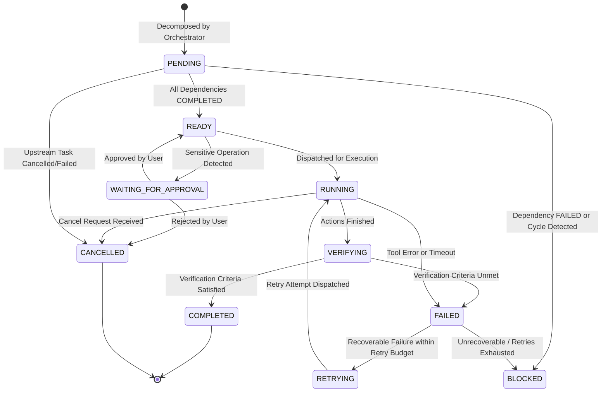

# CodeMind Phase 6 — Advanced Autonomy and Workflow Orchestration: Architecture Specification

## 1. Executive Summary & Architectural Goals

Phase 6 upgrades CodeMind from a bounded task-execution agent into an autonomous, long-running software engineering orchestrator. While Phases 1–5 established the runtime loop, local model adapters, persistent SQLite memory, and extensible skills, complex engineering tasks (e.g., multi-file refactoring, full-stack feature development, test-driven bug repairs) require structured decomposition, dependency tracking, failure recovery, atomic checkpointing, and rigorous verification.

### Core Architectural Invariants:
1. **Single-Agent Architecture**: CodeMind remains a single-agent runtime. All orchestration, planning, execution, and verification occur within a cohesive, single-agent control loop. No multi-agent coordination frameworks are introduced.
2. **Model Independence**: Operates locally with `qwen3.6:35b` via Ollama without requiring paid cloud APIs, model downloads, or model weight fine-tuning.
3. **Evidence-Grounded Completion**: No task is marked `COMPLETED` without satisfying tangible verification criteria (e.g., exit codes, passing unit tests, file presence, non-empty diffs).
4. **Untrusted Planning & Operations**: Tasks generated by model reasoning cannot bypass `WorkspaceSandbox` boundaries, ignore permission modes, or perform unsafe parallel file mutations.
5. **Deterministic Resumption**: Execution can be interrupted at any point and reliably resumed from atomic checkpoints without duplicate side effects or ambiguous state.

---

## 2. Component Architecture Overview

```
┌────────────────────────────────────────────────────────────────────────────────────────┐
│                                 User / CLI Entry Point                                 │
│          codemind "task instruction"  │  codemind task <status|inspect|pause...>       │
└───────────────────────────────────────────┬────────────────────────────────────────────┘
                                            │
┌───────────────────────────────────────────▼────────────────────────────────────────────┐
│                             WorkflowOrchestrator                                       │
│  Coordinates Lifecycle: Plan -> Schedule -> Execute -> Verify -> Checkpoint -> Report  │
└───────┬──────────────┬──────────────┬──────────────┬──────────────┬─────────────┬──────┘
        │              │              │              │              │             │
┌───────▼──────┐┌──────▼──────┐┌──────▼──────┐┌──────▼──────┐┌──────▼─────┐┌──────▼──────┐
│ Hierarchical ││ Intelligent ││ Execution   ││ Concurrency ││ Atomic     ││ Multi-Tier  │
│  Task DAG    ││   Recovery  ││   Budgets   ││  & Conflict ││ Checkpoint ││ Verification│
│   Planner    ││   Engine    ││  & Controls ││   Detector  ││   Store    ││   Runner    │
└───────┬──────┘└──────┬──────┘└──────┬──────┘└──────┬──────┘└──────┬─────┘└──────┬──────┘
        │              │              │              │              │             │
┌───────▼──────────────▼──────────────▼──────────────▼──────────────▼─────────────▼──────┐
│                               Runtime Agent Engine                                     │
│     ContextBudget  │  SkillRegistry  │  SQLiteProjectMemory  │  ToolRegistry           │
│     ModelAdapter   │  AgentLoop      │  WorkspaceSandbox     │  PermissionChecker      │
└────────────────────────────────────────────────────────────────────────────────────────┘
```

---

## 3. Advanced Task Planning & Hierarchical DAG

### 3.1 Task State Machine

The task lifecycle supports 10 explicit, mutually exclusive states:



### 3.2 Task Decomposition Data Schema

Each task node contains rich metadata for execution scheduling:

```python
class TaskPriority(str, Enum):
    LOW = "low"
    NORMAL = "normal"
    HIGH = "high"
    CRITICAL = "critical"

class TaskComplexity(str, Enum):
    TRIVIAL = "trivial"   # 1 turn, single tool call
    MODERATE = "moderate" # 2-4 turns, multiple edits
    COMPLEX = "complex"   # 5+ turns, test-driven repair

class TaskStatus(str, Enum):
    PENDING = "pending"
    READY = "ready"
    RUNNING = "running"
    WAITING_FOR_APPROVAL = "waiting_for_approval"
    BLOCKED = "blocked"
    FAILED = "failed"
    RETRYING = "retrying"
    VERIFYING = "verifying"
    COMPLETED = "completed"
    CANCELLED = "cancelled"

class VerificationCriterion(BaseModel):
    criterion_type: str  # "file_exists", "test_passes", "command_exits_zero", "diff_contains"
    target: str          # File path, test pattern, or command string
    expected_value: str = ""
    actual_value: str = ""
    satisfied: bool = False

class HierarchicalTask(BaseModel):
    id: str                            # Stable identifier (e.g., "task-1.2")
    parent_id: str | None = None       # Parent task identifier for subtasks
    title: str
    description: str = ""
    priority: TaskPriority = TaskPriority.NORMAL
    complexity: TaskComplexity = TaskComplexity.MODERATE
    status: TaskStatus = TaskStatus.PENDING
    dependencies: list[str] = Field(default_factory=list) # Task IDs that must reach COMPLETED
    preconditions: list[str] = Field(default_factory=list) # Conditions required prior to execution
    postconditions: list[str] = Field(default_factory=list)# Invariants guaranteed upon completion
    expected_outputs: list[str] = Field(default_factory=list) # Target files, endpoints, or artifacts
    verification_criteria: list[VerificationCriterion] = Field(default_factory=list)
    relevant_files: list[str] = Field(default_factory=list)
    mutated_files: list[str] = Field(default_factory=list)
    retry_count: int = 0
    max_retries: int = 3
    evidence: str = ""
    error_message: str = ""
    started_at: str | None = None
    completed_at: str | None = None
```

### 3.3 DAG Validation & Topological Scheduling
- **Cycle Detection**: Kahn's algorithm verifies that the task dependency graph is a Directed Acyclic Graph (DAG). If a cycle is detected, conflicting tasks transition to `BLOCKED`.
- **Readiness Resolution**: A task transitions to `READY` if and only if all tasks in its `dependencies` list have reached `COMPLETED`.
- **Topological Dispatch**: Tasks are executed in topological order, prioritized by `TaskPriority` and reverse complexity.

---

## 4. Intelligent Failure Recovery Engine

### 4.1 Error Taxonomy & Classification
Failures encountered during execution are classified into 10 structured categories:

| Error Category | Root Cause Examples | Deterministic Recovery Behavior | Max Retries |
|---|---|---|:---:|
| **`MODEL_RESPONSE_FAILURE`** | Model HTTP 500, socket disconnect, truncation | Exponential backoff retry; verify model health endpoint | 3 |
| **`INVALID_PROTOCOL`** | Malformed JSON, missing envelope fields | Structured loopback correction prompt with minimal schema | 3 |
| **`TOOL_EXECUTION_FAILURE`** | `apply_patch` mismatch, invalid command syntax | Re-read target file to refresh context; fallback to `create_file` | 2 |
| **`MISSING_DEPENDENCY`** | `ImportError`, missing npm/pip package | Propose installation or update project manifest; replan | 2 |
| **`TEST_FAILURE`** | Assertion error, unexpected exception | Test-driven repair: analyze traceback, inspect diff, apply fix | 3 |
| **`BUILD_FAILURE`** | Compilation syntax error, typecheck failure | Parse compiler output line numbers; apply targeted patch | 3 |
| **`PERMISSION_DENIED`** | User denied shell command, read-only mode | Do NOT retry blindly; transition task to `BLOCKED` or escalate | 0 |
| **`TIMEOUT`** | Tool execution exceeded `tool_timeout_seconds` | Terminate process; retry with extended timeout or split task | 1 |
| **`CONTEXT_EXHAUSTION`** | Model prompt exceeds context token window | Summarize history, compact observations, reload memory/skills | 2 |
| **`UNCERTAIN_OUTCOME`** | Tool crashed mid-write, socket severed | Re-read filesystem to determine if file changed; reconcile | 1 |

### 4.2 Non-Idempotency Protection
Operations that mutate disk or execute non-idempotent commands (e.g. `git commit`, `alembic upgrade`, database writes) are tracked with transactional idempotency flags. If an outcome is uncertain, CodeMind verifies disk state before re-running rather than executing a duplicate side effect.

---

## 5. Atomic Checkpointing & State Resumption

### 5.1 Checkpoint Store Schema (`.codemind/checkpoints/<session_id>.checkpoint.json`)
The checkpoint manager captures an immutable, recoverable state after every major phase transition:

```json
{
  "checkpoint_id": "ckpt-20261116-112000-a1b2c3",
  "session_id": "cm-20261116-111500-f1e2d3",
  "timestamp": "2026-11-16T11:20:00Z",
  "instruction": "Implement user auth with JWT and test suite",
  "current_task_id": "task-2",
  "execution_position": 2,
  "tasks": [
    {
      "id": "task-1",
      "title": "Create JWT helper module",
      "status": "completed",
      "evidence": "src/auth/jwt.py created, 4/4 tests pass"
    },
    {
      "id": "task-2",
      "title": "Implement auth middleware",
      "status": "running",
      "mutated_files": ["src/auth/middleware.py"]
    }
  ],
  "completed_task_ids": ["task-1"],
  "pending_task_ids": ["task-3"],
  "failed_task_ids": [],
  "tool_observations": [
    {"tool": "create_file", "path": "src/auth/jwt.py", "ok": true}
  ],
  "files_created": ["src/auth/jwt.py"],
  "files_modified": [],
  "permission_state": {"mode": "supervised", "approvals": ["run_command:pytest"]},
  "verification_evidence": {
    "task-1": [{"criterion": "test_passes", "passed": true}]
  }
}
```

### 5.2 Atomic Write Protocol
To prevent corruption during sudden power loss or process kill (`SIGINT`, `SIGKILL`):
1. State is serialized to a temporary file: `<file>.tmp.<pid>`.
2. `os.fsync()` flushes data to physical disk storage.
3. `os.replace()` atomically swaps the temporary file into the final checkpoint path.

---

## 6. Execution Budgets, Controls & Concurrency

### 6.1 Configurable Execution Budgets (`ExecutionBudget`)
```python
class ExecutionBudget(BaseModel):
    max_turns: int = 40                  # Turn limit across entire orchestrator run
    max_tool_calls: int = 60             # Cumulative tool call budget
    max_retries_per_task: int = 3        # Retry limit per task
    max_execution_time_seconds: int = 600# Total workflow execution timeout (10 min)
    max_concurrent_operations: int = 2   # Maximum safe parallel operations
    max_file_modifications: int = 25     # Maximum files mutated per workflow
```

### 6.2 Conflict Detection & Controlled Parallelism
Before parallel execution of two `READY` tasks $T_A$ and $T_B$:
1. **File Overlap Check**:
   $$\text{relevant\_files}(T_A) \cap \text{mutated\_files}(T_B) = \emptyset$$
   $$\text{mutated\_files}(T_A) \cap \text{mutated\_files}(T_B) = \emptyset$$
2. **Dependency Boundary Check**: Neither task can have an unresolved transitive dependency on the other.
3. **Tool Safety Check**: Read-only tools (`read_file`, `list_directory`, `search_files`) can run concurrently. Destructive or mutating tools (`apply_patch`, `create_file`, terminal commands) require exclusive locks.

If any overlap is detected, tasks are serialized deterministically based on priority.

---

## 7. Multi-Tier Verification & Honest Reporting

CodeMind enforces strict evidence boundaries:

```
┌────────────────────────────────────────────────────────┐
│               Honest Completion Status                 │
├──────────────────────────┬─────────────────────────────┤
│ COMPLETED_VERIFIED       │ All tasks executed AND      │
│                          │ all verification checks pass│
├──────────────────────────┼─────────────────────────────┤
│ COMPLETED_UNVERIFIED     │ Code created but no test    │
│                          │ runner or verification check│
├──────────────────────────┼─────────────────────────────┤
│ PARTIALLY_COMPLETED      │ Some tasks finished; other  │
│                          │ tasks pending or blocked    │
├──────────────────────────┼─────────────────────────────┤
│ BLOCKED                  │ Unmet dependency, rejected  │
│                          │ permission, or cycle        │
├──────────────────────────┼─────────────────────────────┤
│ FAILED                   │ Fatal tool or test failure  │
└──────────────────────────┴─────────────────────────────┘
```

---

## 8. CLI Command Specifications

The CLI is extended with the `codemind task` command group:

```bash
codemind task status             # Display real-time progress of active workflow DAG
codemind task inspect <id>       # View detailed task node, dependencies, evidence, criteria
codemind task pause <id>         # Safely checkpoint and pause active task execution
codemind task resume <id>        # Resume execution from last safe checkpoint
codemind task cancel <id>        # Gracefully abort workflow and mark active tasks CANCELLED
codemind task history            # Display history of past workflow runs and checkpoints
```

---

## 9. Phase 6 Benchmark Evaluation Suite (`benchmarks/phase_6/`)

The evaluation will rigorously validate 15 scenarios (A through O) in isolated workspaces:

- **Scenario A**: Complex multi-file feature implementation.
- **Scenario B**: Dependency-aware execution planning (DAG topological ordering).
- **Scenario C**: Recovery from malformed model output.
- **Scenario D**: Recovery from a failed test (test-driven repair).
- **Scenario E**: Recovery from a failed build (syntax/import correction).
- **Scenario F**: Interrupted execution and atomic checkpoint restoration.
- **Scenario G**: User approval during a sensitive operation.
- **Scenario H**: Task cancellation and graceful shutdown.
- **Scenario I**: Independent task execution with controlled parallelism.
- **Scenario J**: Detection of conflicting operations (preventing concurrent file edits).
- **Scenario K**: Context exhaustion and plan continuation via memory compaction.
- **Scenario L**: Long-running workflow with multiple verification checkpoints.
- **Scenario M**: Honest reporting of partially completed tasks.
- **Scenario N**: Recovery when tool execution outcome is uncertain.
- **Scenario O**: End-to-end software engineering task.

Comparison with Phase 5 execution loop will measure model turns, tool calls, retry efficiency, duplicate operations, and verification integrity.
