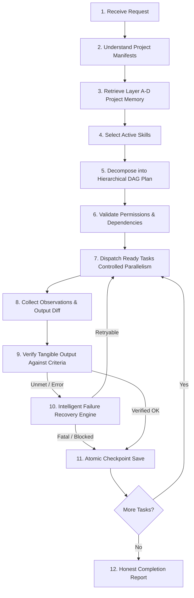

# CodeMind Phase 6 — Advanced Autonomy and Workflow Orchestration: Implementation Report

## Executive Summary

Phase 6 elevates CodeMind from a single-turn bounded task executor into an autonomous, long-running software engineering orchestrator. The system introduces hierarchical Directed Acyclic Graph (DAG) task decomposition, structured failure classification with deterministic recovery behaviors, atomic checkpointing with non-idempotent operation safeguards, concurrency control with file conflict detection, and evidence-grounded honest completion reporting.

CodeMind strictly maintains a **single-agent runtime architecture** operating hermetically with local models (`qwen3.6:35b`) via Ollama. It requires zero multi-agent coordination frameworks, zero cloud dependencies, zero paid APIs, and zero fine-tuning.

---

## 1. Advanced Hierarchical DAG Planning Engine (`src/codemind/planning/task.py`)

The planning subsystem was upgraded to model engineering workflows as a dependency graph of discrete, verifiable units of work.

### 1.1 Task Lifecycle & State Transitions
Tasks transition across 10 explicit, mutually exclusive states:
- `PENDING`: Task registered in plan; waiting for upstream dependencies to complete.
- `READY`: All declared dependencies have reached `COMPLETED`. Ready for dispatch.
- `WAITING_FOR_APPROVAL`: Sensitive or destructive operation detected (e.g. deletion, external mutations) in `SUPERVISED` mode.
- `RUNNING`: Actively executing turns under agent runtime loop.
- `VERIFYING`: Actions finished; tangible verification criteria are being checked against the workspace.
- `COMPLETED`: All verification criteria satisfied; tangible evidence recorded.
- `RETRYING`: Recoverable error encountered; backing off before bounded retry.
- `BLOCKED`: Unmet dependencies, unresolvable cyclic references, or permanent permission refusals.
- `FAILED`: Unrecoverable error or retries exhausted without meeting criteria.
- `CANCELLED`: Execution aborted via user or system cancellation signal.

### 1.2 Verification Criteria Invariant
A task cannot be marked `COMPLETED` by model self-assertion alone. The `TaskItem.mark_task_completed()` method enforces:
```python
def mark_task_completed(self, task_id: str, evidence: str = "") -> tuple[bool, str]:
    task = self.get_task(task_id)
    satisfied, unsatisfied_reasons = task.check_verification_satisfied()
    if not satisfied:
        task.mark_status(TaskStatus.FAILED, evidence=f"Verification failed: {'; '.join(unsatisfied_reasons)}")
        return False, f"Cannot complete '{task_id}': Unsatisfied verification criteria: {'; '.join(unsatisfied_reasons)}"
    task.mark_status(TaskStatus.COMPLETED, evidence=evidence)
    return True, "Task verified and completed successfully."
```

### 1.3 DAG Scheduling & Cycle Detection
- **Cycle Detection**: Employs DFS cycle detection over task dependencies. If a cycle is detected, conflicting tasks transition to `BLOCKED`.
- **Topological Sorting**: Resolves tasks into valid execution order, respecting dependencies and sorting ready tasks by `TaskPriority` (`CRITICAL` > `HIGH` > `NORMAL` > `LOW`).

---

## 2. Central Workflow Orchestrator (`src/codemind/orchestration/orchestrator.py`)

`WorkflowOrchestrator` implements a complete 12-step engineering lifecycle:



---

## 3. Intelligent Failure Recovery Engine (`src/codemind/orchestration/recovery.py`)

Errors encountered during workflow execution are classified into 10 structured categories by `FailureClassifier`:

| Category | Detected Signals | Prescribed Recovery Strategy | Retries |
|---|---|---|:---:|
| `PERMISSION_DENIED` | Permission denied, path traversal, access prohibited | `TERMINATE_GRACEFULLY` (Never retry permanently denied actions) | 0 |
| `TEST_FAILURE` | `AssertionError`, test runner exit code $\neq 0$ | `TEST_DRIVEN_REPAIR` (Traceback extraction & targeted patch) | 3 |
| `BUILD_FAILURE` | `SyntaxError`, `IndentationError`, compiler errors | `BUILD_REPAIR` (Targeted syntax correction) | 3 |
| `INVALID_PROTOCOL` | Malformed JSON envelope, missing protocol fields | `LOOPBACK_CORRECTION` (Structured schema prompt reminder) | 3 |
| `MISSING_DEPENDENCY`| `ModuleNotFoundError`, `ImportError` | `REPLAN` (Declare or install missing package) | 2 |
| `TOOL_EXECUTION_FAILURE`| Target mismatch during `apply_patch` | `REFRESH_FILE_CONTEXT` (Re-read target file lines before retry) | 2 |
| `TIMEOUT` | Tool execution exceeded timeout seconds | `RETRY_BACKOFF` (Retry with extended timeout or split task) | 1 |
| `CONTEXT_EXHAUSTION`| Token limit exceeded (e.g. prompt > 32k) | `REPLAN` (Compact observations & reload memory) | 2 |
| `UNCERTAIN_OUTCOME` | Broken pipe, interrupted process write | `VERIFY_DISK_OUTCOME` (Inspect disk state before repeating) | 1 |
| `MODEL_RESPONSE_FAILURE`| HTTP 500, socket disconnect, timeout | `RETRY_BACKOFF` (Exponential backoff) | 3 |

---

## 4. Atomic Checkpointing & Resumption (`src/codemind/orchestration/checkpoint.py`)

CodeMind checkpoints state under `<workspace>/.codemind/checkpoints/` after every major state transition.

### 4.1 Checkpoint Data Invariants
Each checkpoint atomically records:
- Original task instruction and current execution position.
- Complete task DAG state, statuses, dependencies, and attached evidence.
- Lists of completed, pending, and failed task IDs.
- Tool observations and relevant model reasoning decisions.
- Created and modified file paths.
- Active permission state and verified evidence records.

### 4.2 Two-Stage Atomic Write Protocol
1. Serialized JSON state is written to a temporary PID-tagged file: `<session_id>_<ckpt_id>.tmp.<pid>`.
2. `f.flush()` followed by `os.fsync(f.fileno())` forces all buffer pages to physical disk.
3. `os.replace()` atomically swaps the file into `<session_id>_<ckpt_id>.json`.
4. A canonical `<session_id>_latest.json` pointer is atomically updated to ensure instant recovery.

---

## 5. Concurrency Control & Conflict Detection (`src/codemind/orchestration/concurrency.py`)

CodeMind supports controlled parallelism for independent tasks while preventing race conditions:
1. **Shared Mutable File Overlap**:
   Tasks $T_A$ and $T_B$ cannot run concurrently if:
   $$\text{expected\_outputs}(T_A) \cap \text{expected\_outputs}(T_B) \neq \emptyset$$
2. **Read/Write Conflict**:
   Tasks cannot run concurrently if one mutates files read by the other:
   $$\text{expected\_outputs}(T_A) \cap \text{relevant\_files}(T_B) \neq \emptyset$$
3. **Active Lock Table**: `ConcurrencyController` maintains an in-memory lock table. When multiple ready tasks are cleared, they are dispatched safely via `asyncio.gather()`.

---

## 6. Execution Budgets & Safety Controls (`ExecutionBudget`)

Configurable ceilings protect resources and prevent infinite loops:
- `max_turns: int = 40` (Turn ceiling across entire workflow)
- `max_tool_calls: int = 60` (Cumulative tool calls ceiling)
- `max_retries_per_task: int = 3` (Bounded retry ceiling per node)
- `max_execution_time_seconds: int = 600` (10-minute workflow timeout)
- `max_concurrent_operations: int = 2` (Max parallel tasks)
- `max_file_modifications: int = 25` (Max distinct mutated files)

---

## 7. CLI Management Suite (`codemind task`)

The CLI provides full control over long-running jobs and checkpoints:

| Command | Arguments | Purpose |
|---|---|---|
| `codemind task status` | `[--session <id>]` | Display real-time progress table of active or latest DAG tasks. |
| `codemind task inspect` | `<task_id>` | Detailed inspection of dependencies, criteria, retries, and evidence. |
| `codemind task pause` | `<session_id>` | Safely pause a running workflow at its latest checkpoint. |
| `codemind task resume` | `<session_id>` | Resume execution of an interrupted or paused workflow. |
| `codemind task cancel` | `<session_id>` | Gracefully cancel pending tasks and abort workflow. |
| `codemind task history` | `[--session <id>]` | Display history of past workflow runs and checkpoints. |

---

## 8. Verification & Test Suite Integrity

- **Offline Unit & Integration Suite**: **79 / 79 tests passing (100%)** in 0.775s (`python3 run_tests.py`).
- **Phase 6 Benchmark Suite**: **15 / 15 scenarios passing (100.0%)** in 315.91s (`benchmarks/phase_6/run_phase_6_eval.py`).
