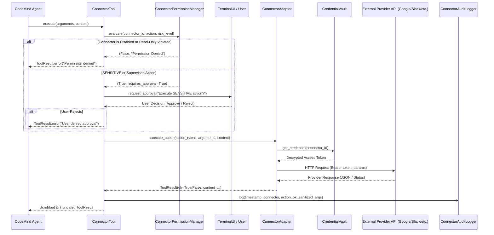

# CodeMind — Universal App Connector Ecosystem Architecture

## 1. Overview and Core Philosophy

CodeMind extends from a local-first software engineering assistant into an autonomous companion equipped with a **Universal Application Connector Ecosystem**. Users can connect everyday communication, productivity, media, and cloud platforms (YouTube, Gmail, Google Drive, Google Calendar, Discord, Slack, Notion, and Spotify) directly into CodeMind's tool execution runtime, without sending credentials or unredacted data to external third-party middleware.

```mermaid
flowchart TD
    User([User / CLI / REPL]) --> Agent[CodeMindAgent Runtime]
    Agent --> Registry[ToolRegistry]
    
    subgraph ConnectorsGateway[Universal Connector Gateway]
        CM[ConnectorManager]
        CReg[ConnectorRegistry]
        CPM[ConnectorPermissionManager]
        CAL[ConnectorAuditLogger]
        CV[CredentialVault (Fernet + SQLite)]
        CAM[ConnectorAuthManager / OAuthManager]
    end

    Agent --> CM
    CM --> CV
    CM --> CAM
    CM --> CPM
    CM --> CAL
    CM --> CReg

    subgraph NativeConnectors[Native Connectors]
        YOUTUBE[YouTube Connector]
        GMAIL[Gmail Connector]
        DRIVE[Google Drive Connector]
        CALENDAR[Google Calendar Connector]
        DISCORD[Discord Connector]
        SLACK[Slack Connector]
        NOTION[Notion Connector]
        SPOTIFY[Spotify Connector]
    end

    CReg --> YOUTUBE
    CReg --> GMAIL
    CReg --> DRIVE
    CReg --> CALENDAR
    CReg --> DISCORD
    CReg --> SLACK
    CReg --> NOTION
    CReg --> SPOTIFY

    subgraph MCPClient[Enhanced MCP Client]
        MCPMgr[MCPManager]
        MCPServer1[Local Stdio Server]
        MCPServer2[Remote SSE / HTTP Server]
    end

    Agent --> MCPMgr
    MCPMgr --> MCPServer1
    MCPMgr --> MCPServer2
```

---

## 2. Component Taxonomy

### 2.1 ConnectorRegistry
Maintains a dynamic registry of all known application adapters. Provides discovery by category (`media`, `communication`, `storage`, `productivity`) and keyword search over adapter IDs, names, descriptions, and action capabilities.

### 2.2 ConnectorManager
Coordinates the lifecycle of all adapters:
- Instantiates singleton connector adapters on demand.
- Injects `CredentialVault`, `ConnectorAuthManager`, `ConnectorPermissionManager`, and `ConnectorAuditLogger`.
- Interrogates adapters for active connection health.
- Gathers active tools and exposes `register_tools_with(tool_registry)` to register them into CodeMind's central `ToolRegistry`.

### 2.3 ConnectorManifest
Declarative metadata contract describing:
- Unique connector ID (e.g. `youtube`, `gmail`, `discord`).
- Display name, icon emoji, description, and semantic version.
- Authentication method (`oauth2`, `api_key`, `bot_token`, `none`).
- Required OAuth scopes.
- Action definitions (`ConnectorAction`), risk tiers (`READ`, `WRITE`, `SENSITIVE`), and dynamic Pydantic argument schemas.

### 2.4 ConnectorAdapter (Abstract Base Class)
Contract implemented by all native application integrations:
- `manifest`: Static `ConnectorManifest`.
- `check_health()`: Live endpoint ping verifying token validity, network latency, and user identity.
- `execute_action(action_name, params, context)`: Dispatches action to official provider REST endpoints.
- `disconnect()`: Revokes credentials at provider if supported and cleans up local vault state.

### 2.5 ConnectorTool
Wraps any `ConnectorAction` into CodeMind's native `BaseTool` interface:
- Compiles JSON Schema dictionaries dynamically into validated Pydantic model classes via `make_connector_args_schema()`.
- Enforces user permission gates and supervised interactive approvals before making network requests.
- Measures execution duration and writes sanitized audit records to `.codemind/connectors/audit.jsonl`.
- Truncates oversized responses to protect model context window limits.

### 2.6 CredentialVault
Cryptographically isolated local storage:
- Master key (`.codemind/.vault_key`) generated via `cryptography.fernet.Fernet` and restricted with POSIX file permissions `0o600` (read/write by owner only).
- SQLite database (`.codemind/vault.db`) storing AES-128-CBC + HMAC-SHA256 encrypted payload blobs.
- Completely prevents raw tokens from being checked into version control or plaintext project files.

### 2.7 ConnectorAuditLogger
Append-only JSONL log (`.codemind/connectors/audit.jsonl`):
- Records timestamp, connector ID, action, risk level, execution duration, and success/failure codes.
- Automatically passes all arguments, headers, and error messages through `redact_secrets()` to ensure zero credential leakage.

---

## 3. Execution Pipeline & Security Flow

When a user or agent invokes a connector tool:


