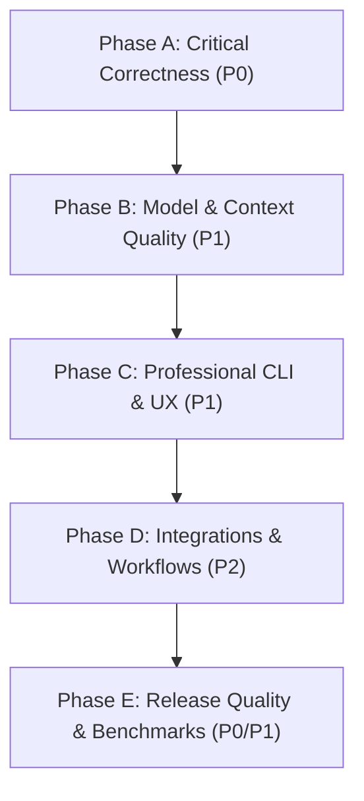

# CodeMind Reliability & Capability Improvement Roadmap

> **Authoritative Specification:** Derived from `CodeMind_Reliability_and_Capability_Improvement_Plan.md`  
> **Target:** CodeMind CLI / Milo Agent Runtime  
> **Status:** Active Execution Phase A  

---

## 1. Executive Mandate & Non-Negotiable Principles

The primary objective of CodeMind CLI is not to simulate autonomy or print optimistic completion messages. Its sole objective is to **safely execute real software engineering work and prove what was completed with tangible evidence**.

### Non-Negotiable Invariants:
1. **Never False Success:** A task that is paused, failed, cancelled, awaiting approval, or unverified must **never** be reported as `VERIFIED SUCCESS` or `COMPLETED`.
2. **Domain Separation:** Passing CodeMind CLI's internal test suite (`python run_tests.py`) proves only that CodeMind itself is healthy. It **never** proves that the user's requested deliverable was implemented or verified.
3. **Strict Task File Attribution:** A task's completion report must list **only** files created or modified by that specific task. Stale files from prior tasks (`insta_gram`, `flappy_bird`, etc.) must never leak into subsequent task reports.
4. **Resilient Protocol & Bounded Recovery:** Malformed model responses must be safely normalized, parsed, and retried within strict bounds without exhausting the turn budget or triggering rogue tool calls.

---

## 2. Phased Delivery Roadmap

### Phase A: Critical Correctness (P0 — Immediate Focus)
- **Workstream A: Model Protocol Reliability**
  - Decouple transport decoding, response normalization, protocol parsing, and semantic dispatch.
  - Implement strict bounds on malformed response retries.
  - Guard against plain text accidentally executing tools.
- **Workstream B: Task Isolation & File Change Ledger**
  - Implement task-scoped identity (`task_id`, `session_id`, `event_id`).
  - Replace mutable cumulative lists with an immutable task-scoped `FileChangeLedger`.
  - Isolate worker proposals and baseline workspace state.
- **Workstream C: Honest Verification & Completion State Invariant**
  - Decouple System Health checks from User Acceptance Criteria.
  - Fix status evaluation logic in `HonestCompletionReport`.
  - Enforce completion invariant: `COMPLETED` requires all acceptance criteria passed and zero blocking failures.
- **Workstream D: Turn Budget & Recovery**
  - Distinguish model requests, tool calls, and repair cycles.
  - Prevent wasteful loops and freeze state safely on turn exhaustion (`PAUSED`).
  - Validate checkpoints before resuming; prevent non-idempotent replays.

### Phase B: Model & Context Quality (P1)
- **Workstream E: Unified Model Gateway**
  - Uniform provider interface (`ModelAdapter`) across Ollama, OpenAI `/v1`, and custom inference.
  - Explicit capability profiles (`JSON_SCHEMA`, `STREAMING`, `TOOL_CALLING`).
  - Observable, transparent fallback without silent cloud routing.
- **Workstream F: Context Management & Compaction**
  - Context assembly prioritization (User Request > Task State > Tools > Sources > Directives > Skills > Memory > History).
  - In-session context compaction (`/compact`) when reaching 80% context window threshold.
  - Token and utilization observability.

### Phase C: Professional CLI (P1)
- **Workstream G: Professional Interactive Terminal**
  - Integrate `prompt_toolkit` for multi-line editing, command history, and tab completion.
  - Real-time status header and budget gauge.
  - Slash command parser (`/help`, `/status`, `/doctor`, `/models`, `/memory`, `/diff`, `/clear`).
- **Workstream H: File Mentions (`@file`)**
  - Workspace-relative `@` fuzzy file path completion.
  - Bounded context injection with secret shielding.

### Phase D: Integrations & Workflows (P2)
- **Workstream I: Model Context Protocol (MCP)**
  - Local stdio MCP client behind `ToolRegistry` with approval gating.
- **Workstream J: Git & GitHub Workflows**
  - Branch management, commit message drafting, diff inspection, and PR automation.
- **Workstream K: Fine-Grained Permission Policies**
  - Persistent pattern-based allow/ask/deny rules (e.g., `npm test`, `pytest`).

### Phase E: Release Quality & Benchmarks (P0/P1)
- **Workstream L: Observability & Telemetry**
  - Precise latency, inference duration, token speed, and queue tracking.
- **Workstream M: End-to-End Evaluation Matrix**
  - 9 benchmark categories evaluated with full artifact proofs.

---

## 3. Phase A Milestone Exit Criteria

Phase A is strictly complete only when:
1. `HonestCompletionReport` returns `PAUSED` when turn budget is exhausted, with zero claims of success.
2. Consecutive tasks in the same session report **only** their own file modifications.
3. Running `codemind` with a feature request that is incomplete reports `INCOMPLETE` or `FAILED`, regardless of whether CodeMind CLI's internal unit tests pass.
4. All regression tests in `tests/reliability/` pass hermetically.
